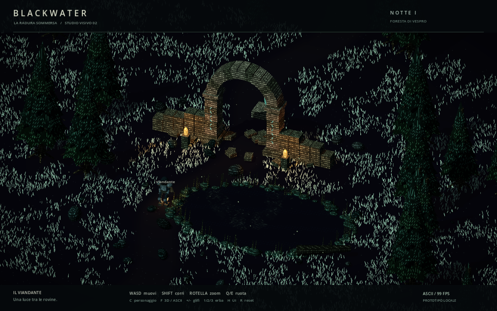
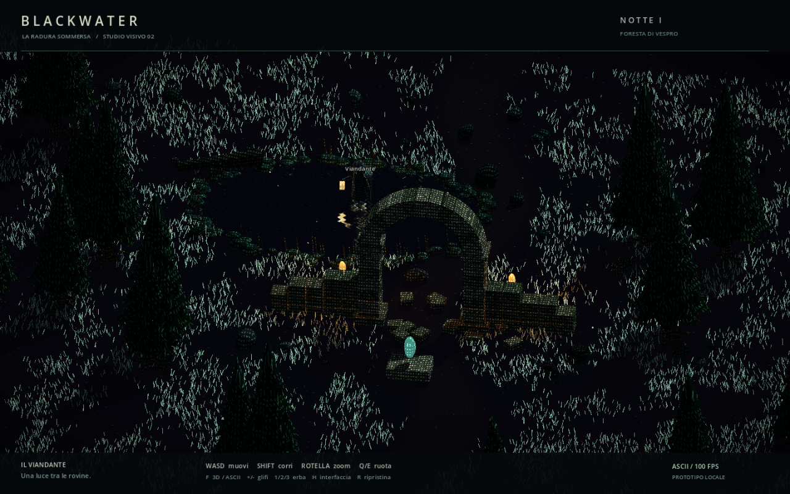
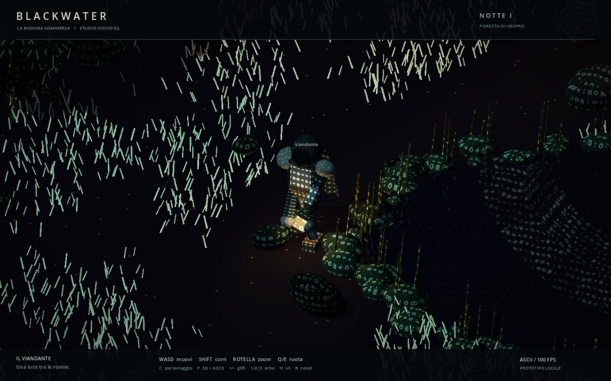

<div align="center">

# BLACKWATER

### A dark fantasy world, written in glyphs.

**An ASCII-inspired 3D RPG prototype built with Godot. Growing toward an MMORPG, one system at a time.**

[](https://godotengine.org/)
[](LICENSE)
[](docs/ROADMAP.md)

[Try the prototype](#try-the-prototype) · [How it works](docs/ARCHITECTURE.md) · [Roadmap](docs/ROADMAP.md) · [Contribute](CONTRIBUTING.md)

</div>



Walk into a ruined clearing. Carry a small light through the trees. Watch broken stone and a wandering figure reflect in the water.

Blackwater explores a simple visual idea: **characters should describe a world with depth, weight and atmosphere.** Stone, cloth, metal, grass and water each have their own glyph language. The scene uses real 3D geometry and lighting, with characters attached to surfaces and vegetation.

> **Current state:** a local, single-player visual and locomotion prototype. The MMORPG is the long-term direction. Multiplayer, combat, quests, inventory and persistence are not implemented yet. The current in-game interface is in Italian.

## In the clearing today

- **Surface-attached ASCII materials** that follow the ruins and the character as the camera moves.
- **Glyph grass** with wind, irregular patches and open paths that leave room for silhouettes.
- **Dark water and planar reflections**, including the animated wanderer.
- **Procedural idle, walking and running**, with two-segment legs and planted feet during stance.
- **A lantern-lit character**, an orbiting orthographic camera and a close-up inspection view.
- **Live visual controls** for glyph scale, grass density and an ASCII / solid-3D comparison.

<details>
<summary><strong>More in-game screenshots</strong></summary>





These are real captures from the prototype. The hero image shows the current source running from a clean copy; the alternate view documents the renderer study and the close-up shows the locomotion pass. They are not concept art or target renders.

</details>

## Try the prototype

**Tested with Godot 4.7.2, standard edition, on Windows using Forward+ and Direct3D 12.** No .NET SDK, third-party addon, account or server is needed. Other platforms and older Godot versions have not been validated.

1. Install [Godot](https://godotengine.org/download/).
2. Clone the repository:

   ```sh
   git clone https://github.com/AndreaZero/ascii-mmorpg-game.git
   cd ascii-mmorpg-game
   ```

3. Import `project.godot` in Godot, allow the initial import to finish, then press **F5**.

The clearing is generated at runtime: the mostly empty scene in the editor is expected. There is no packaged game release yet.

### Controls

| Key | Action |
| --- | --- |
| WASD / arrows | Move relative to the camera |
| Shift | Run |
| Mouse wheel | Zoom |
| Q / E | Orbit the camera |
| C | Toggle character close-up and follow camera |
| F | Compare ASCII and solid 3D rendering |
| + / - | Change glyph size |
| 1 / 2 / 3 | Sparse / normal / dense grass |
| H | Toggle the interface |
| R | Reset character and view |

For a first look: walk around the pond, orbit with **Q/E**, then press **C** and hold **Shift** to inspect the stride.

## How the image is built

The renderer combines an orthographic 3D scene, a runtime font atlas, material-specific glyph shaders, billboarded grass and a second viewport for reflections. Character placement follows surfaces rather than a uniform screen-wide text grid. A subtle dark fill preserves silhouettes between glyphs; this is an ASCII-inspired visual style, not a terminal renderer.

Everything in the clearing is built procedurally in GDScript. Fonts come from the operating system; no commercial font files or reference images are bundled. Read the [architecture notes](docs/ARCHITECTURE.md) for the rendering pipeline, locomotion and current trade-offs.

## Where this goes next

The immediate focus is **character readability and motion**, followed by environment polish and interaction. A small multiplayer experiment comes after the local foundations are worth playing. There are no promised release dates or player-count claims.

See the [roadmap](docs/ROADMAP.md) and [development notes](docs/DEVELOPMENT.md). The original [Italian development log](docs/DEVLOG.it.md) preserves the early visual studies and checks.

## Follow or contribute

If this visual direction interests you, **star the repository** to help others discover it, and **watch releases** for future packaged builds. Useful feedback is specific: a screenshot, the camera angle, glyph density, hardware and what became difficult to read.

[Report a bug](https://github.com/AndreaZero/ascii-mmorpg-game/issues/new?template=bug_report.yml), [suggest an improvement](https://github.com/AndreaZero/ascii-mmorpg-game/issues/new?template=visual_feedback.yml), or read [CONTRIBUTING.md](CONTRIBUTING.md) before opening a pull request.

## License and credits

Code and original project media are available under the [MIT License](LICENSE). Created by [AndreaZero](https://github.com/AndreaZero). Built with [Godot Engine](https://godotengine.org/). See [credits](docs/CREDITS.md) for visual inspiration and asset provenance.
